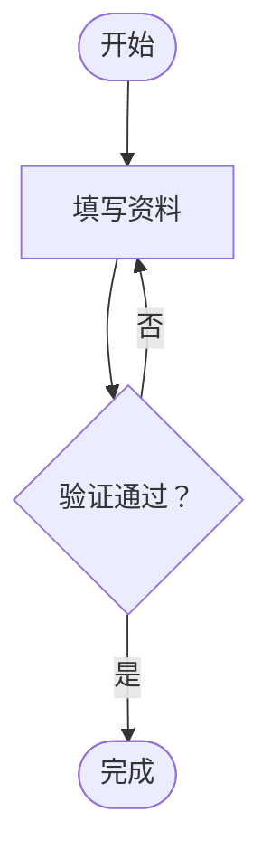
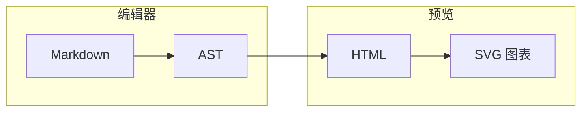
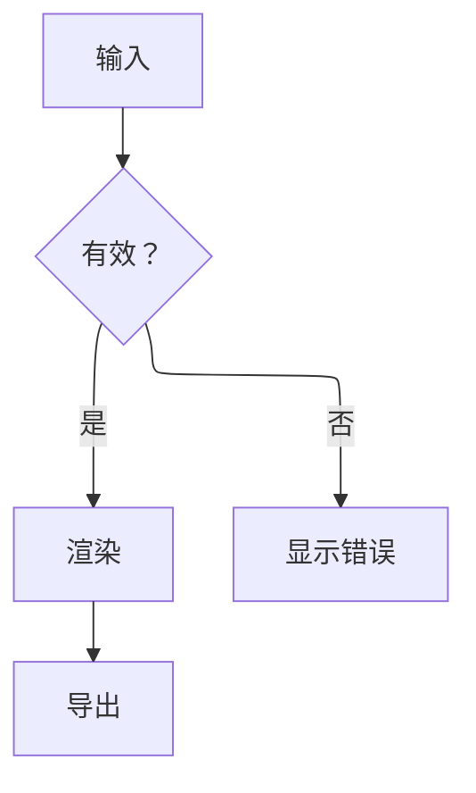
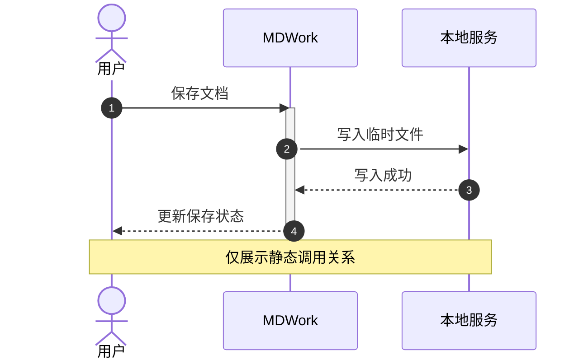
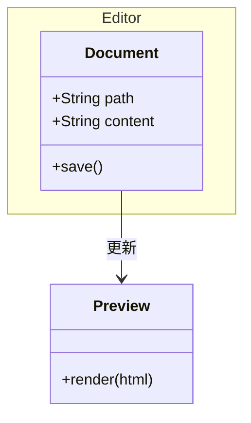
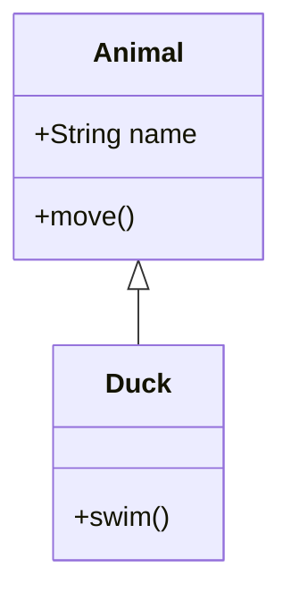
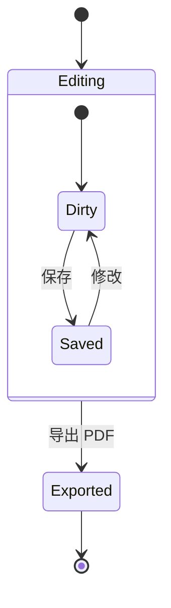
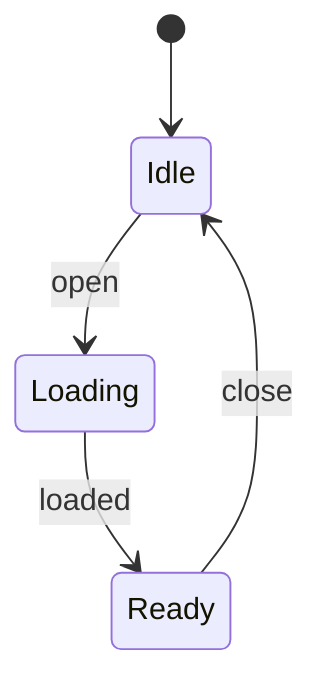
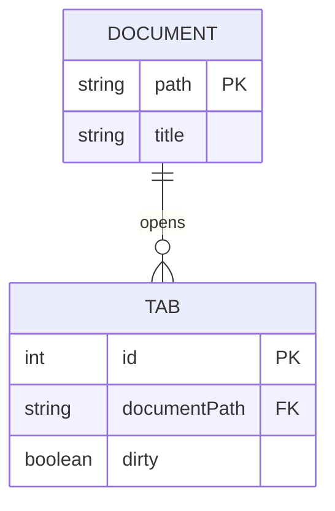
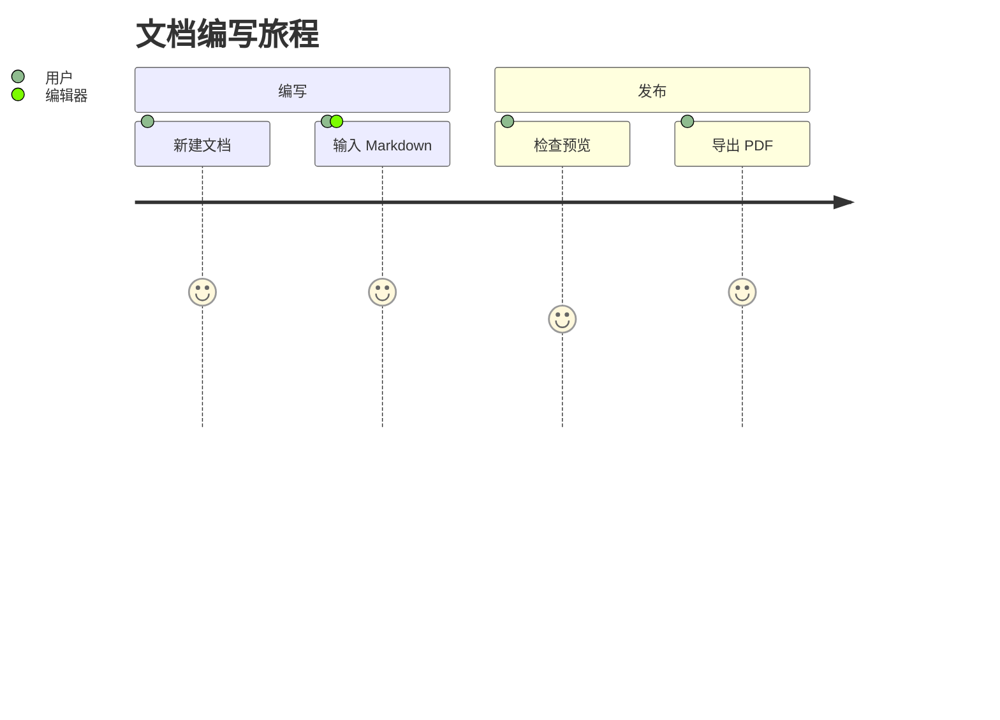

# Mermaid 全图型示例库

> 本文件由 `npm run examples:generate` 根据 `tests/mermaidCompatibilityCases.ts` 生成。
> 这些案例同时用于真实 Electron/Chromium 的内联 SVG 与 PDF 图片渲染测试。
> 每个案例包含预览和“完整 Markdown”代码块。复制时使用“完整 Markdown”代码块，内容已包含围栏，可直接粘贴到 MDWork。

在 MDWork 桌面版中打开本文件即可逐个查看。详细语法、简写和安全边界见
[Mermaid 与图表详细教程](../mermaid-guide.zh-CN.md)。

GitHub Wiki 可以预览标准 `mermaid` 图型；MDWork 专用围栏需要复制到 MDWork 查看。

当前共 48 个案例，基线为 Mermaid 11.17.2。

## 1. 流程图 / Flowchart

案例 ID：`flowchart`；围栏：`mermaid`。

预览：


完整 Markdown（使用此代码块的复制按钮）：

````markdown

````

## 2. 传统 Graph 声明

案例 ID：`graph`；围栏：`mermaid`。

预览：



完整 Markdown（使用此代码块的复制按钮）：

````markdown

````

## 3. ELK 流程图布局

案例 ID：`flowchart-elk`；围栏：`mermaid`。

预览：



完整 Markdown（使用此代码块的复制按钮）：

````markdown

````

## 4. 时序图 / Sequence

案例 ID：`sequence`；围栏：`mermaid`。

预览：



完整 Markdown（使用此代码块的复制按钮）：

````markdown

````

## 5. 类图 / Class

案例 ID：`class`；围栏：`mermaid`。

预览：



完整 Markdown（使用此代码块的复制按钮）：

````markdown

````

## 6. ClassDiagram-v2 兼容声明

案例 ID：`class-v2`；围栏：`mermaid`。

预览：



完整 Markdown（使用此代码块的复制按钮）：

````markdown

````

## 7. 状态图 / State v2

案例 ID：`state`；围栏：`mermaid`。

预览：



完整 Markdown（使用此代码块的复制按钮）：

````markdown

````

## 8. 传统 State 声明

案例 ID：`state-legacy`；围栏：`mermaid`。

预览：



完整 Markdown（使用此代码块的复制按钮）：

````markdown

````

## 9. 实体关系图 / ER

案例 ID：`er`；围栏：`mermaid`。

预览：



完整 Markdown（使用此代码块的复制按钮）：

````markdown

````

## 10. 用户旅程图 / Journey

案例 ID：`journey`；围栏：`mermaid`。

预览：



完整 Markdown（使用此代码块的复制按钮）：

````markdown

````

## 11. 甘特图 / Gantt

案例 ID：`gantt`；围栏：`mermaid`。

预览：

```mermaid
gantt
  title MDWork 迭代计划
  dateFormat YYYY-MM-DD
  axisFormat %m-%d
  section 编辑器
  多标签页: done, tabs, 2026-10-27, 2d
  大文件优化: active, large, after tabs, 3d
  section 发布
  兼容验证: verify, after large, 2d
```

完整 Markdown（使用此代码块的复制按钮）：

````markdown
```mermaid
gantt
  title MDWork 迭代计划
  dateFormat YYYY-MM-DD
  axisFormat %m-%d
  section 编辑器
  多标签页: done, tabs, 2026-10-27, 2d
  大文件优化: active, large, after tabs, 3d
  section 发布
  兼容验证: verify, after large, 2d
```
````

## 12. 需求图 / Requirement

案例 ID：`requirement`；围栏：`mermaid`。

预览：

```mermaid
requirementDiagram
  requirement large_file {
    id: 1
    text: Large files remain editable.
    risk: high
    verifymethod: test
  }
  element editor {
    type: component
    docref: editor.md
  }
  editor - satisfies -> large_file
```

完整 Markdown（使用此代码块的复制按钮）：

````markdown
```mermaid
requirementDiagram
  requirement large_file {
    id: 1
    text: Large files remain editable.
    risk: high
    verifymethod: test
  }
  element editor {
    type: component
    docref: editor.md
  }
  editor - satisfies -> large_file
```
````

## 13. Git 图 / GitGraph

案例 ID：`gitgraph`；围栏：`mermaid`。

预览：

```mermaid
gitGraph
  commit id: "初始化"
  branch feature
  checkout feature
  commit id: "图表"
  commit id: "教程"
  checkout main
  merge feature id: "发布"
```

完整 Markdown（使用此代码块的复制按钮）：

````markdown
```mermaid
gitGraph
  commit id: "初始化"
  branch feature
  checkout feature
  commit id: "图表"
  commit id: "教程"
  checkout main
  merge feature id: "发布"
```
````

## 14. 饼图 / Pie

案例 ID：`pie`；围栏：`mermaid`。

预览：

```mermaid
pie showData
  title 文档内容构成
  "正文" : 55
  "代码" : 25
  "图表" : 20
```

完整 Markdown（使用此代码块的复制按钮）：

````markdown
```mermaid
pie showData
  title 文档内容构成
  "正文" : 55
  "代码" : 25
  "图表" : 20
```
````

## 15. 象限图 / Quadrant

案例 ID：`quadrant`；围栏：`mermaid`。

预览：

```mermaid
quadrantChart
  title 功能优先级
  x-axis 低价值 --> 高价值
  y-axis 低投入 --> 高投入
  quadrant-1 重点规划
  quadrant-2 优先实施
  quadrant-3 暂缓
  quadrant-4 快速完成
  多标签页: [0.85, 0.45]
  大文件优化: [0.9, 0.8]
  隐藏字符: [0.65, 0.2]
```

完整 Markdown（使用此代码块的复制按钮）：

````markdown
```mermaid
quadrantChart
  title 功能优先级
  x-axis 低价值 --> 高价值
  y-axis 低投入 --> 高投入
  quadrant-1 重点规划
  quadrant-2 优先实施
  quadrant-3 暂缓
  quadrant-4 快速完成
  多标签页: [0.85, 0.45]
  大文件优化: [0.9, 0.8]
  隐藏字符: [0.65, 0.2]
```
````

## 16. XY 图表

案例 ID：`xychart`；围栏：`mermaid`。

预览：

```mermaid
xychart-beta
  title "月度输出"
  x-axis [Jan, Feb, Mar, Apr]
  y-axis "篇数" 0 --> 100
  bar [20, 40, 70, 90]
  line [10, 30, 50, 70]
```

完整 Markdown（使用此代码块的复制按钮）：

````markdown
```mermaid
xychart-beta
  title "月度输出"
  x-axis [Jan, Feb, Mar, Apr]
  y-axis "篇数" 0 --> 100
  bar [20, 40, 70, 90]
  line [10, 30, 50, 70]
```
````

## 17. XY 图表兼容声明

案例 ID：`xychart-legacy`；围栏：`mermaid`。

预览：

```mermaid
xychart
  x-axis [A, B, C]
  y-axis 0 --> 10
  line [2, 5, 8]
```

完整 Markdown（使用此代码块的复制按钮）：

````markdown
```mermaid
xychart
  x-axis [A, B, C]
  y-axis 0 --> 10
  line [2, 5, 8]
```
````

## 18. 时间线 / Timeline

案例 ID：`timeline`；围栏：`mermaid`。

预览：

```mermaid
timeline
  title MDWork 发展时间线
  2026 第一季度 : Markdown 内核 : 实时预览
  2026 第二季度 : PDF 导出 : VS Code 扩展
  2026 第三季度 : 图表兼容 : 多文档编辑
```

完整 Markdown（使用此代码块的复制按钮）：

````markdown
```mermaid
timeline
  title MDWork 发展时间线
  2026 第一季度 : Markdown 内核 : 实时预览
  2026 第二季度 : PDF 导出 : VS Code 扩展
  2026 第三季度 : 图表兼容 : 多文档编辑
```
````

## 19. 思维导图 / Mindmap

案例 ID：`mindmap`；围栏：`mermaid`。

预览：

```mermaid
mindmap
  root((MDWork))
    编辑[Monaco 编辑器]
      隐藏字符
      大文件
    预览(实时预览)
      图表{{静态 SVG}}
    结构))思维导图((
    导出)PDF(
      静态内容
        :::important
```

完整 Markdown（使用此代码块的复制按钮）：

````markdown
```mermaid
mindmap
  root((MDWork))
    编辑[Monaco 编辑器]
      隐藏字符
      大文件
    预览(实时预览)
      图表{{静态 SVG}}
    结构))思维导图((
    导出)PDF(
      静态内容
        :::important
```
````

## 20. 横向思维导图（MDWork 扩展）

案例 ID：`mindmap-horizontal`；围栏：`mindmap LR`。

预览：

```mindmap LR
root((MDWork))
  编辑[Monaco]
    多标签
    大文件
  预览(实时预览)
  导出{{PDF}}
```

完整 Markdown（使用此代码块的复制按钮）：

````markdown
```mindmap LR
root((MDWork))
  编辑[Monaco]
    多标签
    大文件
  预览(实时预览)
  导出{{PDF}}
```
````

## 21. 纵向思维导图（MDWork 扩展）

案例 ID：`mindmap-vertical`；围栏：`mindmap TD`。

预览：

```mindmap TD
root((MDWork))
  编辑[Monaco]
    隐藏字符
    多标签
  图表(静态 SVG)
    流程图
    时序图
  导出{{PDF}}
```

完整 Markdown（使用此代码块的复制按钮）：

````markdown
```mindmap TD
root((MDWork))
  编辑[Monaco]
    隐藏字符
    多标签
  图表(静态 SVG)
    流程图
    时序图
  导出{{PDF}}
```
````

## 22. 看板 / Kanban

案例 ID：`kanban`；围栏：`mermaid`。

预览：

```mermaid
kanban
  todo[待办]
    docs[编写图表教程]
  doing[进行中]
    test[真实 SVG 验证]
  done[完成]
    map[思维导图支持]
```

完整 Markdown（使用此代码块的复制按钮）：

````markdown
```mermaid
kanban
  todo[待办]
    docs[编写图表教程]
  doing[进行中]
    test[真实 SVG 验证]
  done[完成]
    map[思维导图支持]
```
````

## 23. C4 系统上下文图

案例 ID：`c4-context`；围栏：`mermaid`。

预览：

```mermaid
C4Context
  title MDWork 系统上下文
  Person(user, "用户", "编写和发布 Markdown 文档")
  System(mdwork, "MDWork", "编辑、预览并导出文档")
  System_Ext(filesystem, "本地文件系统", "保存 Markdown、图片和 PDF")
  Rel(user, mdwork, "使用")
  Rel(mdwork, filesystem, "读写")
```

完整 Markdown（使用此代码块的复制按钮）：

````markdown
```mermaid
C4Context
  title MDWork 系统上下文
  Person(user, "用户", "编写和发布 Markdown 文档")
  System(mdwork, "MDWork", "编辑、预览并导出文档")
  System_Ext(filesystem, "本地文件系统", "保存 Markdown、图片和 PDF")
  Rel(user, mdwork, "使用")
  Rel(mdwork, filesystem, "读写")
```
````

## 24. C4 容器图

案例 ID：`c4-container`；围栏：`mermaid`。

预览：

```mermaid
C4Container
  title MDWork 容器图
  Person(user, "用户")
  System_Boundary(app, "MDWork") {
    Container(renderer, "渲染进程", "React", "编辑器和实时预览")
    Container(main, "主进程", "Electron", "文件和 PDF 服务")
  }
  ContainerDb(storage, "本地存储", "文件系统", "Markdown 与 PDF")
  Rel(user, renderer, "操作")
  Rel(renderer, main, "IPC")
  Rel(main, storage, "读写")
```

完整 Markdown（使用此代码块的复制按钮）：

````markdown
```mermaid
C4Container
  title MDWork 容器图
  Person(user, "用户")
  System_Boundary(app, "MDWork") {
    Container(renderer, "渲染进程", "React", "编辑器和实时预览")
    Container(main, "主进程", "Electron", "文件和 PDF 服务")
  }
  ContainerDb(storage, "本地存储", "文件系统", "Markdown 与 PDF")
  Rel(user, renderer, "操作")
  Rel(renderer, main, "IPC")
  Rel(main, storage, "读写")
```
````

## 25. C4 组件图

案例 ID：`c4-component`；围栏：`mermaid`。

预览：

```mermaid
C4Component
  title 渲染进程组件
  Container_Boundary(renderer, "渲染进程") {
    Component(editor, "Monaco 编辑器", "组件", "接收用户输入")
    Component(parser, "Markdown 内核", "TypeScript", "生成 AST 与 HTML")
    Component(preview, "安全预览", "React", "展示 HTML 与 SVG")
  }
  Rel(editor, parser, "文本")
  Rel(parser, preview, "安全 HTML")
```

完整 Markdown（使用此代码块的复制按钮）：

````markdown
```mermaid
C4Component
  title 渲染进程组件
  Container_Boundary(renderer, "渲染进程") {
    Component(editor, "Monaco 编辑器", "组件", "接收用户输入")
    Component(parser, "Markdown 内核", "TypeScript", "生成 AST 与 HTML")
    Component(preview, "安全预览", "React", "展示 HTML 与 SVG")
  }
  Rel(editor, parser, "文本")
  Rel(parser, preview, "安全 HTML")
```
````

## 26. C4 动态图

案例 ID：`c4-dynamic`；围栏：`mermaid`。

预览：

```mermaid
C4Dynamic
  title 保存文档调用关系
  Person(user, "用户")
  Container(editor, "编辑器", "Monaco", "提供文档内容")
  Container(fileService, "文件服务", "Electron", "原子写入")
  Rel(user, editor, "1. 保存")
  Rel(editor, fileService, "2. 提交内容")
  Rel(fileService, editor, "3. 返回路径")
```

完整 Markdown（使用此代码块的复制按钮）：

````markdown
```mermaid
C4Dynamic
  title 保存文档调用关系
  Person(user, "用户")
  Container(editor, "编辑器", "Monaco", "提供文档内容")
  Container(fileService, "文件服务", "Electron", "原子写入")
  Rel(user, editor, "1. 保存")
  Rel(editor, fileService, "2. 提交内容")
  Rel(fileService, editor, "3. 返回路径")
```
````

## 27. C4 部署图

案例 ID：`c4-deployment`；围栏：`mermaid`。

预览：

```mermaid
C4Deployment
  title MDWork 部署图
  Deployment_Node(desktop, "用户电脑", "macOS / Windows") {
    Deployment_Node(runtime, "Electron 运行时", "桌面进程") {
      Container(app, "MDWork", "桌面应用", "本地编辑与导出")
    }
    Deployment_Node(storage, "文件系统", "本地磁盘") {
      ContainerDb(files, "文档文件", "Markdown / PDF", "用户数据")
    }
  }
  Rel(app, files, "读写")
```

完整 Markdown（使用此代码块的复制按钮）：

````markdown
```mermaid
C4Deployment
  title MDWork 部署图
  Deployment_Node(desktop, "用户电脑", "macOS / Windows") {
    Deployment_Node(runtime, "Electron 运行时", "桌面进程") {
      Container(app, "MDWork", "桌面应用", "本地编辑与导出")
    }
    Deployment_Node(storage, "文件系统", "本地磁盘") {
      ContainerDb(files, "文档文件", "Markdown / PDF", "用户数据")
    }
  }
  Rel(app, files, "读写")
```
````

## 28. 桑基图 / Sankey

案例 ID：`sankey`；围栏：`mermaid`。

预览：

```mermaid
sankey-beta
  Markdown,Preview,60
  Markdown,PDF,25
  Markdown,Share,15
  Preview,Revision,20
```

完整 Markdown（使用此代码块的复制按钮）：

````markdown
```mermaid
sankey-beta
  Markdown,Preview,60
  Markdown,PDF,25
  Markdown,Share,15
  Preview,Revision,20
```
````

## 29. Sankey 兼容声明

案例 ID：`sankey-legacy`；围栏：`mermaid`。

预览：

```mermaid
sankey
  A,B,10
  A,C,5
  B,D,4
```

完整 Markdown（使用此代码块的复制按钮）：

````markdown
```mermaid
sankey
  A,B,10
  A,C,5
  B,D,4
```
````

## 30. 数据包图 / Packet

案例 ID：`packet`；围栏：`mermaid`。

预览：

```mermaid
packet-beta
  title "TCP 数据包"
  0-15: "源端口"
  16-31: "目标端口"
  32-63: "序列号"
  64-79: "窗口"
  80-95: "校验和"
```

完整 Markdown（使用此代码块的复制按钮）：

````markdown
```mermaid
packet-beta
  title "TCP 数据包"
  0-15: "源端口"
  16-31: "目标端口"
  32-63: "序列号"
  64-79: "窗口"
  80-95: "校验和"
```
````

## 31. Packet 兼容声明

案例 ID：`packet-legacy`；围栏：`mermaid`。

预览：

```mermaid
packet
  0-7: "Type"
  8-15: "Code"
  16-31: "Checksum"
```

完整 Markdown（使用此代码块的复制按钮）：

````markdown
```mermaid
packet
  0-7: "Type"
  8-15: "Code"
  16-31: "Checksum"
```
````

## 32. 块图 / Block

案例 ID：`block`；围栏：`mermaid`。

预览：

```mermaid
block-beta
  columns 3
  Editor["编辑器"] Preview["预览"] Export["导出"]
  Workspace["MDWork 工作区"]:3
```

完整 Markdown（使用此代码块的复制按钮）：

````markdown
```mermaid
block-beta
  columns 3
  Editor["编辑器"] Preview["预览"] Export["导出"]
  Workspace["MDWork 工作区"]:3
```
````

## 33. Block 兼容声明

案例 ID：`block-legacy`；围栏：`mermaid`。

预览：

```mermaid
block
  columns 2
  A["输入"] B["输出"]
  C["处理"]:2
```

完整 Markdown（使用此代码块的复制按钮）：

````markdown
```mermaid
block
  columns 2
  A["输入"] B["输出"]
  C["处理"]:2
```
````

## 34. 架构图 / Architecture

案例 ID：`architecture`；围栏：`mermaid`。

预览：

```mermaid
architecture-beta
  group api(cloud)[API]
  service db(database)[Database] in api
  service disk(disk)[Storage] in api
  service server(server)[Server] in api
  db:L -- R:server
  disk:T -- B:server
```

完整 Markdown（使用此代码块的复制按钮）：

````markdown
```mermaid
architecture-beta
  group api(cloud)[API]
  service db(database)[Database] in api
  service disk(disk)[Storage] in api
  service server(server)[Server] in api
  db:L -- R:server
  disk:T -- B:server
```
````

## 35. 雷达图 / Radar

案例 ID：`radar`；围栏：`mermaid`。

预览：

```mermaid
radar-beta
  title "产品能力"
  axis edit["编辑"], preview["预览"], diagram["图表"], export["导出"]
  curve current["当前版本"]{4, 5, 5, 4}
  curve target["目标版本"]{5, 5, 5, 5}
  max 5
  min 0
  graticule polygon
  showLegend true
```

完整 Markdown（使用此代码块的复制按钮）：

````markdown
```mermaid
radar-beta
  title "产品能力"
  axis edit["编辑"], preview["预览"], diagram["图表"], export["导出"]
  curve current["当前版本"]{4, 5, 5, 4}
  curve target["目标版本"]{5, 5, 5, 5}
  max 5
  min 0
  graticule polygon
  showLegend true
```
````

## 36. 泳道图 / Swimlane

案例 ID：`swimlane`；围栏：`mermaid`。

预览：

```mermaid
swimlane-beta
  subgraph Sales
    lead[Qualify lead]
  end
  subgraph Delivery
    ship[Ship order]
  end
  lead --> ship
```

完整 Markdown（使用此代码块的复制按钮）：

````markdown
```mermaid
swimlane-beta
  subgraph Sales
    lead[Qualify lead]
  end
  subgraph Delivery
    ship[Ship order]
  end
  lead --> ship
```
````

## 37. 树状视图 / TreeView

案例 ID：`treeview`；围栏：`mermaid`。

预览：

```mermaid
treeView-beta
index.js
```

完整 Markdown（使用此代码块的复制按钮）：

````markdown
```mermaid
treeView-beta
index.js
```
````

## 38. 事件建模 / Event Modeling

案例 ID：`eventmodeling`；围栏：`mermaid`。

预览：

```mermaid
eventmodeling
  tf 01 ui UI
  tf 02 cmd RunAction
  tf 03 evt ActionExecuted
```

完整 Markdown（使用此代码块的复制按钮）：

````markdown
```mermaid
eventmodeling
  tf 01 ui UI
  tf 02 cmd RunAction
  tf 03 evt ActionExecuted
```
````

## 39. 石川图 / Ishikawa

案例 ID：`ishikawa`；围栏：`mermaid`。

预览：

```mermaid
ishikawa-beta
Problem
Cause A
Cause B
```

完整 Markdown（使用此代码块的复制按钮）：

````markdown
```mermaid
ishikawa-beta
Problem
Cause A
Cause B
```
````

## 40. 韦恩图 / Venn

案例 ID：`venn`；围栏：`mermaid`。

预览：

```mermaid
venn-beta
set A
set B
union A,B
```

完整 Markdown（使用此代码块的复制按钮）：

````markdown
```mermaid
venn-beta
set A
set B
union A,B
```
````

## 41. 矩形树图 / Treemap

案例 ID：`treemap`；围栏：`mermaid`。

预览：

```mermaid
treemap-beta
"Category A"
  "Item A1": 10
  "Item A2": 20
"Category B"
  "Item B1": 15
```

完整 Markdown（使用此代码块的复制按钮）：

````markdown
```mermaid
treemap-beta
"Category A"
  "Item A1": 10
  "Item A2": 20
"Category B"
  "Item B1": 15
```
````

## 42. Wardley 地图

案例 ID：`wardley`；围栏：`mermaid`。

预览：

```mermaid
wardley-beta
component A [0.5, 0.5]
component B [0.8, 0.2]
A -> B
```

完整 Markdown（使用此代码块的复制按钮）：

````markdown
```mermaid
wardley-beta
component A [0.5, 0.5]
component B [0.8, 0.2]
A -> B
```
````

## 43. Cynefin 框架图

案例 ID：`cynefin`；围栏：`mermaid`。

预览：

```mermaid
cynefin-beta
  complex
```

完整 Markdown（使用此代码块的复制按钮）：

````markdown
```mermaid
cynefin-beta
  complex
```
````

## 44. 铁路图 / Railroad IR

案例 ID：`railroad`；围栏：`mermaid`。

预览：

```mermaid
railroad-beta
rule = terminal("hello") ;
```

完整 Markdown（使用此代码块的复制按钮）：

````markdown
```mermaid
railroad-beta
rule = terminal("hello") ;
```
````

## 45. 铁路图 / EBNF

案例 ID：`railroad-ebnf`；围栏：`mermaid`。

预览：

```mermaid
railroad-ebnf-beta
rule = "terminal" ;
```

完整 Markdown（使用此代码块的复制按钮）：

````markdown
```mermaid
railroad-ebnf-beta
rule = "terminal" ;
```
````

## 46. 铁路图 / ABNF

案例 ID：`railroad-abnf`；围栏：`mermaid`。

预览：

```mermaid
railroad-abnf-beta
rule = "hello" ;
```

完整 Markdown（使用此代码块的复制按钮）：

````markdown
```mermaid
railroad-abnf-beta
rule = "hello" ;
```
````

## 47. 铁路图 / PEG

案例 ID：`railroad-peg`；围栏：`mermaid`。

预览：

```mermaid
railroad-peg-beta
rule <- "hello" ;
```

完整 Markdown（使用此代码块的复制按钮）：

````markdown
```mermaid
railroad-peg-beta
rule <- "hello" ;
```
````

## 48. 信息图 / Info

案例 ID：`info`；围栏：`mermaid`。

预览：

```mermaid
info
  showInfo
```

完整 Markdown（使用此代码块的复制按钮）：

````markdown
```mermaid
info
  showInfo
```
````

---

所有图型均为静态输出，不包含 Mermaid 点击事件或 JavaScript 回调。
