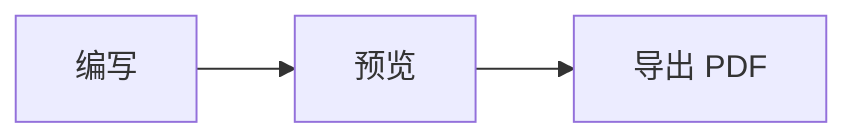
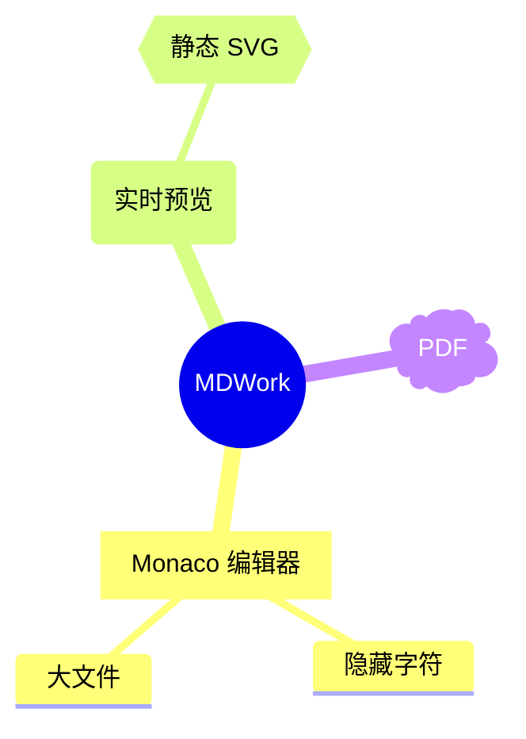

# MDWork Mermaid 与图表详细教程

适用版本：MDWork 1.0.0

图表引擎：Mermaid 11.17.2

配套示例：[48 个已验证图型示例](examples/mermaid-gallery.md)

## 1. 先了解三种写法

MDWork 将 Mermaid 用于**静态图表解析和布局**。它不支持 Mermaid 点击事件、JavaScript 回调或交互模式。

### 1.1 标准 Mermaid 围栏

标准围栏中的源码原样交给 Mermaid。图型声明必须写在正文第一行：

````markdown

````

需要完整 Mermaid 语法、兼容声明或尚未提供简写的图型时，优先使用这种写法。

### 1.2 MDWork 围栏简写

简写由 MDWork 补齐图型声明，减少重复输入：

````markdown
```flowchart LR
  A[编写] --> B[预览] --> C[导出 PDF]
```

```sequence
  actor User as 用户
  participant App as MDWork
  User->>App: 保存
  App-->>User: 完成
```
````

`flowchart` 可写 `TD`、`TB`、`BT`、`LR`、`RL`；省略方向时默认 `TD`。其他简写只补声明，围栏后的附加文字会保留在声明后，因此不要随意填写 Mermaid 不认识的参数。

### 1.3 MDWork 定向思维导图

`mindmap LR` 和 `mindmap TD` 是 MDWork 扩展，不是 Mermaid 原生方向参数。围栏内只写缩进树，不需要再写 `mindmap`：

````markdown
```mindmap LR
root((产品))
  编辑器
    多标签
    隐藏字符
  输出
    静态 SVG
    PDF
```
````

`LR` 从左向右发展，`TD` 从上向下发展。详见[思维导图](#7-思维导图原生与定向模式)。

## 2. 图型与简写速查

下表中的“标准声明”放在 `mermaid` 围栏内；“简写围栏”可直接替代声明。带 `beta` 的图型遵循当前 Mermaid 版本的实验语法，升级引擎后仍应重新验证。

| 图型 | 标准声明 | MDWork 简写围栏 |
| --- | --- | --- |
| 流程图 | `flowchart TD` | `flowchart TD` |
| 传统流程图 | `graph TD` | 使用标准围栏 |
| ELK 流程图 | `flowchart-elk TD` | 使用标准围栏 |
| 时序图 | `sequenceDiagram` | `sequence` |
| 类图 | `classDiagram` / `classDiagram-v2` | `class`（生成 `classDiagram`） |
| 状态图 | `stateDiagram-v2` / `stateDiagram` | `state`（生成 v2） |
| 实体关系图 | `erDiagram` | `er` |
| 用户旅程图 | `journey` | `journey` |
| 甘特图 | `gantt` | `gantt` |
| 需求图 | `requirementDiagram` | 使用标准围栏 |
| Git 图 | `gitGraph` | `gitgraph` |
| 饼图 | `pie` | `pie` |
| 象限图 | `quadrantChart` | `quadrant` |
| XY 图表 | `xychart-beta` / `xychart` | `xychart`（生成 beta） |
| 时间线 | `timeline` | `timeline` |
| 原生思维导图 | `mindmap` | `mindmap` |
| 横向/纵向思维导图 | 无对应原生方向参数 | `mindmap LR` / `mindmap TD` |
| 看板 | `kanban` | `kanban` |
| C4 图 | `C4Context`、`C4Container`、`C4Component`、`C4Dynamic`、`C4Deployment` | 使用标准围栏 |
| 桑基图 | `sankey-beta` / `sankey` | `sankey`（生成 beta） |
| 数据包图 | `packet-beta` / `packet` | `packet`（生成 beta） |
| 块图 | `block-beta` / `block` | `block`（生成 beta） |
| 架构图 | `architecture-beta` | `architecture` |
| 雷达图 | `radar-beta` | `radar` |
| 泳道图 | `swimlane-beta` | 使用标准围栏 |
| 树状视图 | `treeView-beta` | 使用标准围栏 |
| 事件建模 | `eventmodeling` | 使用标准围栏 |
| 石川图 | `ishikawa-beta` | `ishikawa` |
| 韦恩图 | `venn-beta` | `venn` |
| 矩形树图 | `treemap-beta` | `treemap` |
| Wardley 地图 | `wardley-beta` | `wardley` |
| Cynefin 框架图 | `cynefin-beta` | `cynefin` |
| 铁路图 | `railroad-beta`、`railroad-ebnf-beta`、`railroad-abnf-beta`、`railroad-peg-beta` | 使用标准围栏 |
| 信息图 | `info` | 使用标准围栏 |

完整可运行源码见[示例库](examples/mermaid-gallery.md)。仓库的兼容测试覆盖 48 个案例，包括传统声明、beta 声明和两种定向思维导图；每个案例都检查内联 SVG、PDF 图片尺寸与实际图片解码。它验证的是当前内置图型及代表性语法，不表示支持第三方 Mermaid 插件或任意交互脚本。

## 3. 流程图与跨职能流程

### 3.1 节点、判断和连线

````markdown
```flowchart TD
  Start([开始]) --> Input[填写资料]
  Input --> Valid{验证通过？}
  Valid -->|否| Input
  Valid -->|是| Done([完成])
```
````

常用形状：

| 写法 | 含义 |
| --- | --- |
| `A[矩形]` | 普通处理 |
| `A(圆角)` | 圆角处理 |
| `A([体育场形])` | 开始或结束 |
| `A{菱形}` | 条件判断 |
| `A[[子流程]]` | 子流程 |
| `A[(数据库)]` | 数据库 |

常用连线为 `-->`、`---`、`-.->`、`==>`；文字可写成 `A -->|说明| B`。节点 ID 建议使用稳定、无空格的英文标识，显示文字放在括号内。

### 3.2 方向

- `TD` / `TB`：从上到下。
- `BT`：从下到上。
- `LR`：从左到右。
- `RL`：从右到左。

方向只控制自动布局，不会把图表变成可拖动编辑器。修改源码后，MDWork 重新生成静态图。

### 3.3 使用 `subgraph` 表达职责分区

````markdown
```flowchart LR
  subgraph Sales[销售]
    Submit[提交订单]
  end
  subgraph Delivery[交付]
    Review{审核}
    Ship[安排交付]
  end
  Submit --> Review
  Review -->|通过| Ship
  Review -->|驳回| Submit
```
````

这种写法表达角色和流程关系，布局由 Mermaid 计算，不复刻 ProcessOn 的固定泳道网格。`swimlane-beta` 也可通过标准 `mermaid` 围栏使用，最小示例见示例库。

## 4. 时序、类、状态与实体关系

### 4.1 时序图

````markdown
```sequence
  autonumber
  actor User as 用户
  participant App as MDWork
  participant FS as 文件服务
  User->>App: 保存文档
  activate App
  App->>FS: 原子写入
  FS-->>App: 返回路径
  App-->>User: 更新状态
  deactivate App
  Note over User,FS: 静态展示调用关系
```
````

`->>` 表示实线消息，`-->>` 表示虚线返回；`activate` / `deactivate` 表示生命周期，`Note` 添加说明。

### 4.2 类图

````markdown
```class
  class Document {
    +String path
    +save()
  }
  class Preview {
    +render(html)
  }
  Document --> Preview : 更新
```
````

常见关系包括继承 `<|--`、组合 `*--`、聚合 `o--` 和关联 `-->`。需要 `classDiagram-v2` 的传统兼容声明时改用标准围栏。

### 4.3 状态图

````markdown
```state
  [*] --> Editing
  Editing --> Saved: 保存
  Saved --> Editing: 修改
  Editing --> Exported: 导出 PDF
  Exported --> [*]
```
````

`[*]` 表示起点或终点。嵌套复合状态的完整示例见示例库。

### 4.4 ER 图

````markdown
```er
  DOCUMENT ||--o{ TAB : opens
  DOCUMENT {
    string path PK
    string title
  }
  TAB {
    int id PK
    boolean dirty
  }
```
````

关系左侧和右侧符号分别描述两个实体的基数；属性可标注 `PK`、`FK`。

## 5. 计划、旅程与版本历史

### 5.1 甘特图

````markdown
```gantt
  title 文档迭代计划
  dateFormat YYYY-MM-DD
  axisFormat %m-%d
  section 编辑器
  多标签页: done, tabs, 2026-10-27, 2d
  大文件优化: active, large, after tabs, 3d
  section 发布
  兼容验证: verify, after large, 2d
```
````

`dateFormat` 决定日期解析方式；任务可以使用明确日期，也可以使用 `after 任务ID`。示例中的日期只是演示数据，可按项目实际计划修改。

### 5.2 用户旅程与时间线

`journey` 用 `section` 划分阶段，任务格式为“任务: 评分: 参与者”。`timeline` 用时间条目和冒号组织事件。两者的中文示例均已放入示例库。

### 5.3 GitGraph

````markdown
```gitgraph
  commit id: "初始化"
  branch feature
  checkout feature
  commit id: "图表"
  checkout main
  merge feature id: "发布"
```
````

使用 `branch`、`checkout`、`commit`、`merge` 描述静态分支历史，不会操作真实 Git 仓库。

## 6. 数据与结构类图表

### 6.1 饼图、XY 与象限图

````markdown
```pie showData
  title 文档内容构成
  "正文" : 55
  "代码" : 25
  "图表" : 20
```

```xychart
  title "月度输出"
  x-axis [Jan, Feb, Mar, Apr]
  y-axis "篇数" 0 --> 100
  bar [20, 40, 70, 90]
  line [10, 30, 50, 70]
```

```quadrant
  title 功能优先级
  x-axis 低价值 --> 高价值
  y-axis 低投入 --> 高投入
  quadrant-1 重点规划
  quadrant-2 优先实施
  quadrant-3 暂缓
  quadrant-4 快速完成
  多标签页: [0.85, 0.45]
```
````

XY 的分类、坐标轴标题和数值必须遵循当前 Mermaid 解析器要求；遇到未加引号的文字无法解析时，先给标题和分类加引号。

### 6.2 雷达、矩形树、桑基与韦恩图

这些图型分别使用 `radar`、`treemap`、`sankey`、`venn` 简写。当前已验证的桑基图数据采用 ASCII 节点名：

````markdown
```sankey
  Markdown,Preview,60
  Markdown,PDF,25
  Markdown,Share,15
```
````

桑基图的每行是“来源,目标,数值”。不要自行假设当前原生解析器支持引号包围的中文节点；如遇到解析失败，先用 ASCII 节点验证数据，再参考对应版本的原生语法。

### 6.3 数据包与块图

`packet` 用位范围描述协议字段，例如 `0-15: "源端口"`；`block` 用 `columns` 和条目后的跨列数组织块布局。具体示例见示例库。

## 7. 思维导图：原生与定向模式

### 7.1 原生思维导图

标准围栏中使用 `mindmap` 声明：

````markdown

````

缩进决定父子关系。建议使用一致的两个空格缩进，不要混用不规则缩进。常用节点形状：

| 示例 | 形状 |
| --- | --- |
| `root((主题))` | 圆形 |
| `节点[文字]` | 矩形 |
| `节点(文字)` | 圆角矩形 |
| `节点{{文字}}` | 六边形 |
| `节点))文字((` | bang 形状 |
| `节点)文字(` | cloud 形状 |
| 不带括号的 `节点` | 原生默认形状 |

原生模式保留 Mermaid 的自动布局；不要把 `LR` / `TD` 当作原生 `mindmap` 的方向指令。

### 7.2 横向发展

````markdown
```mindmap LR
root((MDWork))
  编辑[Monaco]
    多标签
    大文件
  预览(实时预览)
  导出{{PDF}}
```
````

也可写 `mindmap horizontal` 或 `mindmap h`。MDWork 将缩进树转换为从左到右的静态无箭头树。

### 7.3 纵向发展

````markdown
```mindmap TD
root((MDWork))
  编辑[Monaco]
    隐藏字符
    多标签
  图表(静态 SVG)
    流程图
    时序图
  导出{{PDF}}
```
````

也可写 `mindmap TB`、`mindmap vertical` 或 `mindmap v`。它生成从上到下的静态无箭头树。

### 7.4 定向模式的边界

- 必须只有一个根节点，且至少有一个节点。
- 支持上表六种括号形状和普通文字节点。
- 支持空行、`%%` 注释和节点后的 `:::className` 静态类标记；类名必须是合法标识符。
- 不支持 `::icon(...)` 图标装饰；需要图标等原生能力时，使用标准 `mermaid` + `mindmap`，并接受原生布局。
- 定向模式是受控语法转换，不提供 Mermaid 原生思维导图的全部高级装饰能力。
- 转换错误会显示源行号，不会阻断同一文档中的其他正文。

## 8. C4、架构与其他图型

### 8.1 C4 图

C4 的五种已验证声明为：

- `C4Context`：系统上下文和外部参与者。
- `C4Container`：应用内部的容器或进程。
- `C4Component`：容器内部组件。
- `C4Dynamic`：带顺序的调用关系。
- `C4Deployment`：部署节点和运行环境。

这些图统一使用标准 `mermaid` 围栏，不要在正文前再省略 `C4...` 声明。示例库包含 Person、System、Boundary、Container、Deployment_Node 和 Rel 的可运行写法。

### 8.2 Architecture

必须使用 `architecture-beta`，裸 `architecture` 不是有效的原生声明。可以使用 `architecture` 简写让 MDWork 补齐 `-beta`：

````markdown
```architecture
  group api(cloud)[API]
  service db(database)[Database] in api
  service server(server)[Server] in api
  db:L -- R:server
```
````

### 8.3 实验图型与铁路图

`swimlane-beta`、`treeView-beta`、`eventmodeling`、四种 `railroad-*-beta`、`info` 等均通过标准 `mermaid` 围栏使用。实验语法的功能完整度取决于 Mermaid 11.17.2；MDWork 不为这些图型额外模拟交互或编辑界面。

## 9. 固定分层架构图：`layers`

当需求是固定层数、1–4 列网格、跨列条目和明确配色，而不是 Mermaid 自动布局时，可使用 MDWork 自研 `layers` 围栏：

````markdown
```layers
layer 应用层
color blue
columns 2
group 编辑器
item 多标签
item 大文件
end
group 预览
item Mermaid
item 静态 SVG
end
link 编辑器 -> 预览 | 文档内容

layer 输出层
color green
columns 2
item PDF
span 2
```
````

指令说明：

- `layer`：开始新层，后面的文字是层标签。
- `title`：设置可选层标题。
- `color`：`green`、`yellow`、`orange`、`red`、`blue`、`purple`。
- `columns 1..4`：设置当前层或当前分组的列数。
- `item`：添加条目。
- `span 1..columns`：让上一条目跨列。
- `group` / `end`：定义非嵌套分组。
- `link A -> B | 说明`：分组连线，也支持 `<-` 和 `<>`。

同一层不能混用独立 `item` 和 `group`。同名分组可以显示，但被 `link` 引用时必须唯一。完整四层架构示例见[四层架构图示例](examples/layers-architecture.md)。

## 10. 静态安全边界

MDWork 的 Mermaid 配置以安全和可打印为目标：

- `securityLevel: 'strict'`。
- 使用 SVG 文本标签，不启用 HTML 标签交互。
- 图表 SVG 会再次经过 DOMPurify 清理。
- 不支持 `click` 事件、JavaScript 回调和 `javascript:` URL。
- PDF 使用清理后的 SVG 图片，不执行图表脚本。
- 原始 Markdown HTML 和 PDF 导出端也有各自的安全清理。

因此，来自 Mermaid 官方文档的交互示例不保证可用；应删除 `click ... call ...` 等交互语句，保留静态节点和连线。

## 11. 常见错误排查

### 图表位置显示源码或错误

1. 标准 `mermaid` 围栏是否包含完整声明，例如 `flowchart TD`、`mindmap`。
2. 简写围栏是否重复写了声明。例如 `sequence` 围栏内直接写参与者，不再写 `sequenceDiagram`。
3. 节点括号、引号和 `subgraph` / `end` 是否配对。
4. 缩进树是否只有一个根，是否意外把同级节点写成了第二个根。
5. beta 图型是否使用了当前版本要求的完整声明。

### 中文或引号导致解析失败

MDWork 不替换 Mermaid 的原生词法规则。Requirement、Sankey 等图型对文本格式有各自限制。优先从示例库复制已验证案例，再一次只修改一个字段定位问题。

### 思维导图方向没有变化

- 原生 `mermaid` + `mindmap` 使用 Mermaid 自动布局。
- 要强制横向或纵向，使用 `mindmap LR` 或 `mindmap TD` 围栏，并省略围栏内的 `mindmap` 声明。
- 定向模式只支持上述受控缩进树；高级装饰错误需要移除或改回原生模式。

### 大文档预览没有自动更新

超过 1,000,000 字符的文档默认暂停实时预览，编辑器仍可使用。点击预览区域的“刷新预览”手动解析当前版本；导出 PDF 时会读取活动文档的当前快照，不依赖预览是否已经刷新。

## 12. PDF 导出注意事项

1. 在需要导出的分栏中激活正确文档标签。
2. 先检查图表预览和本地/网络图片。
3. 选择“导出 PDF”，配置纸张、方向、页边距、字体和目录。
4. 导出后检查实际 PDF，而不只看编辑器预览。

图表以静态 SVG 图片进入 PDF。过宽图表、长文本、浮动图片和分页会受 Chromium 打印布局影响；宽幅图可尝试横向纸张、较窄页边距或缩短标签。重要交付文档应逐页检查。

## 13. 开发与兼容验证

```bash
# 重新生成 48 个示例
npm run examples:generate

# 单元测试、类型检查与生产构建
npm test
npm run typecheck
npm run build

# 在真实 Electron/Chromium 中检查内联 SVG 和 PDF 图片
npm run test:mermaid
```

兼容案例集中在 `tests/mermaidCompatibilityCases.ts`，真实浏览器断言位于 `tests/browser/mermaid-compatibility.ts`。新增图型时，应同时添加可运行案例和教程，而不是只添加一个围栏别名。
