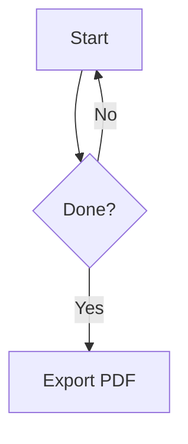

# MDWork Syntax Reference and User Guide

Version: 1.0.0

Products: MDWork Desktop and MDWork Markdown Preview for VS Code

中文版：[user-guide.zh-CN.md](user-guide.zh-CN.md)

## 1. Overview

MDWork is a local Markdown writing, live-preview and PDF-export application. The desktop app places the editor on the left and preview on the right by default. The VS Code extension provides a live preview beside the active Markdown editor.

MDWork uses its own block parser, inline parser, AST and HTML renderer. `markdown-it` is not the main parser. highlight.js provides syntax highlighting, while Mermaid is used only for diagram parsing and layout.

### 1.1 Desktop versus VS Code

| Capability | Desktop | VS Code extension |
| --- | --- | --- |
| Live Markdown preview | Yes | Yes |
| Compact headings and image wrapping | Yes | Yes |
| Mermaid static diagrams and directional mind maps | Yes | Yes |
| Multiple document tabs and independent dirty state | Yes | Use VS Code's own features |
| Up to 4 columns × 3 rows of editor groups | Yes | Use VS Code's own layout |
| Worker parsing and manual preview for large files | Yes | Use VS Code document handling |
| New/Open/Save/Save As | Yes | Use VS Code commands |
| Toolbar image import and copying | Yes | Not provided; manage files in VS Code |
| Styled PDF export | Yes | Not provided |
| System-font settings | Yes | Uses VS Code fonts and themes |

## 2. Downloads and installation

These links point to build artifacts in the project `release` directory. A source-only checkout does not contain binaries until they are built.

- macOS Universal (Apple Silicon + Intel): [MDWork-1.0.0.2-macos-universal.dmg](../release/MDWork-1.0.0.2-macos-universal.dmg)
- macOS Apple Silicon (arm64): [MDWork-1.0.0.2-macos-arm64.dmg](../release/MDWork-1.0.0.2-macos-arm64.dmg)
- Windows x64 portable: [MDWork-1.0.0.2-win.zip](../release/MDWork-1.0.0.2-win.zip)
- VS Code: [MDWork-vscode-1.0.0.2.vsix](../release/MDWork-vscode-1.0.0.2.vsix)
- Checksums: [SHA256SUMS.txt](../release/SHA256SUMS.txt)

### 2.1 macOS

The Universal DMG contains both arm64 and x86_64 architectures and supports Apple Silicon (M-series) and Intel Macs. A separate arm64-only build is also available. If you are unsure which chip your Mac uses, choose the Universal build.

1. Download and open `MDWork-1.0.0.2-macos-universal.dmg`. Apple Silicon users can alternatively choose the smaller `MDWork-1.0.0.2-macos-arm64.dmg`.
2. Drag **MDWork.app** into **Applications**.
3. Eject the disk image.
4. Launch MDWork from Applications or Launchpad.
5. The app is signed with a local Apple Development identity but is **not notarized by Apple**, so macOS may block its first launch. Verify the source and SHA-256 checksum first, then Control-click the app in Finder and choose **Open**, following the system prompt. Do not disable system-wide security protections.
6. Quit the old version before replacing MDWork.app during an upgrade.

### 2.2 Windows

The current Windows x64 deliverable is a **portable ZIP**, not a Setup EXE installer. It does not require installation into a system directory.

1. Download `MDWork-1.0.0.2-win.zip` and verify its SHA-256 checksum.
2. In File Explorer, right-click the ZIP and choose **Extract All**. Extract it to a directory where you have read/write access; do not run the app from inside the ZIP preview.
3. Open the extracted folder and double-click **MDWork.exe**.
4. The portable build does not create Start-menu entries or an uninstaller. Create a shortcut to `MDWork.exe` if needed. To remove it, quit MDWork and delete the entire extracted folder.
5. Quit MDWork before upgrading, then replace the complete extracted directory. Keep your Markdown documents outside the application directory so an upgrade cannot remove them.
6. This release has no Windows code signature, so SmartScreen may display a warning. Continue only after verifying its source and checksum; never use an identically named file from an unknown site.

### 2.3 Install as a VS Code extension

**GUI:**

1. Open the Extensions view.
2. Select the `…` menu in the Extensions view.
3. Choose **Install from VSIX…**.
4. Select `MDWork-vscode-1.0.0.2.vsix` and reload if prompted.
5. Open a Markdown file.
6. Press `Cmd/Ctrl + Shift + P` and run **MDWork: Open Preview**.

**Command line:**

```bash
code --install-extension /absolute/path/MDWork-vscode-1.0.0.2.vsix
```

If `code` is unavailable, run **Shell Command: Install 'code' command in PATH** from the VS Code Command Palette, or use the GUI method.

## 3. Desktop interface and operations

### 3.1 Toolbar

- **New**: creates an empty document tab without replacing open files.
- **Open**: opens a document in a new tab; opening the same path again focuses its existing tab.
- **Save / Save As**: saves the active group's current document, asking for a location if it is untitled.
- **Import image**: copies a selected local image into `assets` beside the document and inserts Markdown.
- **Insert URL**: inserts either an embedded remote image or a link.
- **Export PDF**: exports the active group's document with configurable layout.
- **Edit / Split / Preview**: changes the source/preview view within each editor group.
- **¶ Hidden characters**: toggles space, Tab and invisible-character markers. Spaces appear as dots, Tabs as arrows, and controls, zero-width characters and BOMs as hexadecimal code points such as `[0x00]`, `[0x200B]` and `[0xFEFF]`. These labels are view-only and never modify the source file.
- **Split right / Split down**: adds editor groups up to 4 columns and 3 rows.
- **Single group**: restores one editor group without deleting document tabs.
- **Theme / Settings**: changes the theme or opens font, hidden-character, scroll-sync and auto-save settings.

The current Chinese desktop labels are 新建、打开、保存、另存为、导入图片、插入 URL、导出 PDF、编辑、分栏、预览、¶ 隐藏字符、向右分栏、向下分栏、单栏.

### 3.2 Tabs, editor groups and status bar

- Every open document has one global identity. It can appear in multiple groups while sharing content and dirty state.
- Each group independently selects its active tab. Save, resource insertion and PDF export apply to the active group's document.
- Closing a tab removes only that document view from the current group; other groups keep showing the same file. An adjacent tab is selected when available, and an empty group is removed. Unsaved-change confirmation is required only when closing the file's last group reference.
- The initial editor/preview split is 50:50. Drag the divider between 25% and 75%, or double-click it to restore 50:50.
- Split right creates up to 4 columns and split down up to 3 rows, for at most 12 editor groups. The relevant button is disabled at its limit.
- Normal documents synchronize the active group's preview after editing. The **Refresh preview** button above every preview rereads the current editor content on demand. Other groups wait until activated to avoid parsing multiple large documents at once.
- The status bar shows the active document path, unsaved state, operation messages, character count and line count. A `●` on a tab means that document has unsaved changes.

### 3.3 Shortcuts

| Action | macOS | Windows |
| --- | --- | --- |
| Save | `Cmd + S` | `Ctrl + S` |
| Save As | `Cmd + Shift + S` | `Ctrl + Shift + S` |
| Open | `Cmd + O` | `Ctrl + O` |
| Close active document | `Cmd + W` | `Ctrl + W` |
| VS Code Command Palette | `Cmd + Shift + P` | `Ctrl + Shift + P` |

Undo, redo, find, replace and multi-cursor shortcuts follow Monaco and platform conventions.

### 3.4 Document formats and drag-and-drop

The desktop app reads and writes UTF-8 `.md`, `.markdown`, `.mdown`, `.mkd` and `.txt` files.

Drop one or more supported files into the window to open each as an independent tab. Unsupported extensions are reported and never replace the current document.

Saving uses a temporary file followed by replacement. Each document has independent dirty state and auto-save timing. Auto-save applies only to documents that already have a local path; an untitled document still requires an explicit save location.

Large files are still read completely as UTF-8 into one Monaco model; this is not chunked loading or unlimited-file support. Keystrokes do not copy the full document, and Markdown parsing runs in a Web Worker. At 1,000,000 characters, MDWork disables word wrap and pauses live preview by default. Choose **Refresh preview** to parse the current revision manually. Save and PDF export always read the current document snapshot.

## 4. Editor settings

Open the gear button to configure:

- **Editor font**: source text in the editor.
- **Preview font**: body text in the preview.
- **Code font**: inline code and code blocks.
- **Editor size**: 10–28 in the UI.
- **Preview size**: 12–30 in the UI.
- **Show spaces, Tabs and invisible characters (hexadecimal)**: synchronized with the toolbar toggle; spaces appear as dots, Tabs as arrows, and other invisible characters as hexadecimal code points.
- **Sync preview when editor scrolls**: source-line-based preview positioning in split view.
- **Auto-save after 1.5 seconds**: existing files only.

Fonts are enumerated from the operating system. A font-family name can also be entered directly. No font files are copied or installed. Settings are stored locally; MDWork attempts to read the previous MDReader settings key when upgrading.

## 5. Markdown syntax

### 5.1 Headings

ATX levels 1–6:

```markdown
# Heading 1
## Heading 2
### Heading 3
```

Setext levels 1 and 2:

```markdown
Heading 1
=========

Heading 2
---------
```

A normal `# Heading` follows standard Markdown behavior and does not enter MDWork automatic numbering.

### 5.2 Compact numbered headings (MDWork extension)

Write consecutive ASCII digits, one English letter, or `*` immediately after the hashes, without a space:

```markdown
#9
##8
##7
###6
#*
#4
##3
```

Preview:

```text
1
1.1
1.2
1.2.1
•
2
2.1
```

Rules:

1. Multiple digits are accepted, such as `#12` and `##2026`; embedded spaces are not. `#1 2` is not a compact heading.
2. Source digits select the decimal sequence; actual numbers are corrected according to document order. The source file is not rewritten.
3. `#A` uses `A, B, C … Z, AA …`; `#a` uses the corresponding lowercase sequence.
4. `#*` renders `•`, consumes no number and does not break the sequence.
5. Numbering continues at the same level, resumes at an upper level and restarts at a deeper level.
6. Generated numbers are used by the preview, heading anchors, PDF contents and PDF body.
7. A compact heading contains a generated marker only. Use a normal Markdown heading when heading text is required.

### 5.3 Paragraphs, breaks and escaping

Blank lines separate paragraphs. Two trailing spaces followed by a newline create a hard break. In this example, `␠` marks one space; type ordinary spaces instead:

```text
First line␠␠
Second line
```

Backslash escaping is available for common Markdown punctuation, such as `\*not emphasis\*`. Common named, decimal and hexadecimal entities are supported, including `&amp;`, `&copy;` and `&#169;`.

### 5.4 Emphasis, strikethrough and code spans

```markdown
*emphasis* or _emphasis_
**strong**
**strong with *nested emphasis***
~~strikethrough~~
`const value = 1;`
```

Code-span contents are displayed literally rather than parsed as Markdown.

### 5.5 Lists and task lists

```markdown
- Unordered item
- Another item
  - Indented child

1. First
2. Second

3. Ordered list starting at 3
4. Next

- [x] Done
- [ ] To do
```

Preview checkboxes are read-only. Ordered lists can preserve a start other than 1.

### 5.6 Blockquotes and horizontal rules

```markdown
> A quotation
> with **strong text**.

---
```

Three or more `-`, `_` or `*` characters can form a thematic break under Markdown rules; Setext heading interpretation takes precedence where applicable.

### 5.7 Links

```markdown
[MDWork](https://example.com)
[Link with title](https://example.com "Title")
[Reference link][docs]

[docs]: https://example.com "Documentation"
```

Supported forms include:

- `<https://example.com>` automatic links.
- Automatic email links.
- Bare `http://`, `https://` and `www.` URLs.
- In-preview `#anchor` navigation to headings.
- `#text=words` to find the first matching visible text in the current document.
- `#line=number` to locate a source line; the desktop editor also moves its cursor there.
- Relative file and folder links inside the current document directory.
- HTTP/HTTPS/Mailto links opened by the system browser or mail client.

Current-document navigation examples:

```markdown
[Go to Installation](#installation)
[Go to the PDF Export heading](#pdf-export)
[Find text in this document](#text=words%20to%20find)
[Go to source line 20](#line=20)
```

Headings receive automatic anchors: Chinese `# 安装方法` maps to `#安装方法`, while `## PDF Export` maps to `#pdf-export`. Duplicate headings receive `-2`, `-3` and similar suffixes. Text navigation finds the first visible match without modifying the document. Source lines start at 1. Percent-encode spaces and special characters where needed, as in `#text=PDF%20Export`.

Local file and folder examples:

```markdown
[Open attachment](assets/report.pdf)
[Open a filename with spaces](assets/report%20final.pdf)
[Open the assets folder](assets/)
[Open another document beside this one](notes/other.md)
```

The desktop app opens files and folders with the system default handler. In VS Code, Markdown/text documents open in the editor and folders are revealed in the system file manager. Paths remain relative to the document directory; `../` escapes and symlink escapes are rejected. Save untitled documents first. The target must exist and the operating system must have a suitable handler and permissions. Portable PDF files do not embed these local targets; distribute required local files alongside the PDF.

Choose **link only** in the Insert URL dialog to create a link instead of an image. Special characters in URLs and labels are handled safely.

### 5.8 Standard images and local import

```markdown


```

The desktop importer accepts PNG, JPEG, GIF, WebP, SVG, AVIF and BMP:

1. Save the document first if prompted.
2. Choose **Import image** and select a file.
3. MDWork copies it into `assets` beside the document.
4. Duplicate names receive `-2`, `-3` and similar suffixes; existing files are not overwritten.
5. A relative reference such as `` is inserted.

Relative paths are based on the Markdown file. Both desktop and VS Code restrict local images to the document directory; `../` escapes and symlink escapes are not allowed. Remote images require network access and may be unavailable offline.

### 5.9 Image wrapping, centering and width (MDWork extension)

Add a layout field before the alt text, separated by `|`:

```markdown


The image floats right and this text appears on its left. Keep the image in its own paragraph for predictable wrapping.

::clear

After clearing, this paragraph starts below the floated image.
```

Complete forms:

```markdown


```

| Field | Meaning |
| --- | --- |
| `left` | Float left; text wraps on the right and below. Default width: 40% |
| `right` | Float right; text wraps on the left and below. Default width: 40% |
| `center` | Center as a separate block without text on either side. Default width: 60% |
| Second field | Optional width from `1%`–`100%` or `1px`–`2000px` |
| Final field | Alt text for accessibility and failed-image display |

Examples:

- ``: left float, default width.
- ``: right float at 45%.
- ``: centered at default width.
- ``: centered at 320px, still constrained by container width.

**Stop wrapping:** place `::clear` on its own line, preferably with blank lines around it. It is not displayed as body text; subsequent content starts below the float. Standard `` images are unchanged. The width whitelist never permits arbitrary CSS.

Invalid layout or width fields remain ordinary alt text rather than becoming executable styles.

### 5.10 Fenced code and highlighting

Use at least three backticks or tildes:

````markdown
```ts
interface Document {
  title: string;
}
```
````

The language identifier selects highlight.js highlighting when available. Unknown languages are escaped and displayed as plain text. Unlabelled fences and indented code blocks are also supported.

### 5.11 Mermaid diagrams

Standard fence:

````markdown

````

Flowchart shorthand:

````markdown
```flowchart LR
  A[Write] --> B[Preview]
```
````

The shorthand accepts `TD`, `TB`, `BT`, `LR` and `RL`, defaulting to `TD` when omitted. Other shorthand fences include `sequence`, `class`, `state`, `er`, `gantt`, `pie`, `gitgraph`, `journey`, `timeline`, `kanban`, `quadrant`, `xychart`, `sankey`, `packet`, `block`, `radar`, `treemap`, `venn`, `ishikawa`, `wardley`, `cynefin` and `architecture`.

Native mind maps use a standard `mermaid` fence with a `mindmap` declaration. MDWork also provides directional modes:

````markdown
```mindmap LR
root((MDWork))
  Editor
    Tabs
  Export
    PDF
```
````

Use `TD` instead of `LR` for top-down growth. Directional fences contain a single-root indentation tree without another `mindmap` declaration; icon decorators are not supported in this mode. Use the native fence for advanced native syntax.

Mermaid 11.17.2 runs in strict mode with static SVG output. Click events, JavaScript callbacks and interactive mode are not supported. Diagram errors show the error and original source without blocking other content. Desktop PDF export uses sanitized SVG images.

See the [detailed Chinese Mermaid guide](mermaid-guide.zh-CN.md) and [48 tested examples](examples/mermaid-gallery.md) for the complete diagram/shorthand matrix and troubleshooting.

### 5.12 GFM tables

```markdown
| Left | Center | Right |
| :--- | :---: | ---: |
| A | B | C |
```

Escape a cell pipe as `a\|b`; code spans can also contain pipes. Headers, alignment and multiple body rows are supported.

### 5.13 Raw HTML and security limits

Common embedded HTML is sanitized. Scripts, event handlers, dangerous URLs, forms and raw style attributes do not gain execution capability. Image widths are converted through a dedicated whitelist rather than enabling arbitrary CSS.

This release does **not claim complete support** for math, footnotes, definition lists, wiki links, embedded documents or every pathological CommonMark edge case. Verify such documents rather than assuming those extensions are available.

## 6. PDF export

1. Save or confirm the current content and image paths.
2. Choose **Export PDF**.
3. Configure:
   - Theme: Default, Clean, Academic or Technical.
   - Paper: A4 or Letter.
   - Orientation: portrait or landscape.
   - Margins: 8–40 mm in the UI.
   - Body size: 8–24 pt in the UI.
   - Line height: 1.1–2.5.
   - Body and code font families.
   - Page numbers on or off.
   - Optional table of contents before the body.
   - Code-block and table backgrounds on or off.
4. Choose the destination `.pdf` path.
5. MDWork waits for fonts, images and Mermaid resources, then creates a paginated PDF through Electron `printToPDF`.

The PDF is not a screenshot: toolbars and split panes are excluded. Headings are kept from being stranded at page bottoms where possible, long tables repeat headers and code can wrap. Image wrapping, `::clear`, compact numbers, the TOC and link styling are carried into the PDF. Float pagination follows Chromium layout rules; review important print documents page by page.

The VS Code extension does not currently provide PDF export. Use the desktop app for that workflow.

## 7. Troubleshooting

### An image does not appear

- Resolve paths relative to the Markdown file, not the application installation directory.
- Keep the image inside the document directory and check filename capitalization.
- For remote images, check networking, HTTP/HTTPS and server access policy.
- Save an untitled document before using relative or imported images.

### Text does not wrap

- Start alt with `left|` or `right|` exactly.
- Put the image in its own paragraph, followed by body text.
- Check whether `::clear` occurs before the text.
- `center` never wraps text on both sides.

### Mermaid does not render

- Use a `mermaid` fence with a complete declaration, or a supported shorthand without repeating that declaration.
- Standard fences pass native source through unchanged; directional mind maps use a controlled conversion.
- Native `mindmap` uses automatic layout. Use `mindmap LR` / `mindmap TD` for explicit horizontal or vertical growth.
- Large files pause live preview by default; choose **Refresh preview**. PDF export does not depend on preview freshness.

### A link does not open

- Only HTTP, HTTPS and Mailto are opened externally.
- Relative file links are not a mechanism for launching arbitrary local programs.
- Check the default browser and mail-client configuration.

### PDF images or layout differ

- Confirm that preview images and diagrams have loaded first.
- Remote resources must remain accessible during export.
- Check that selected fonts exist and inspect float/page breaks after export.

## 8. Data and security

MDWork Desktop reads and writes local documents without requiring an account or cloud service. Its renderer has no Node.js integration and uses restricted IPC for files, fonts, images and PDF operations. Local images are confined to the document directory, external protocols are restricted, and HTML/SVG is sanitized. The VS Code Webview uses CSP, typed messages and limited local-resource roots.

Image import copies files. PDF export writes to a user-selected destination. Remote images and external links access the network according to document content and user actions.
