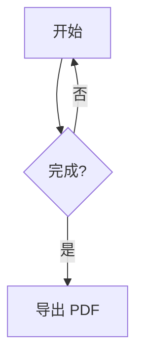

# MDWork 详细语法支持说明与操作手册

版本：1.0.0

适用产品：MDWork 桌面版、MDWork Markdown Preview for VS Code

English version: [user-guide.en-US.md](user-guide.en-US.md)

## 1. 产品说明

MDWork 用于本地 Markdown 编写、实时预览和 PDF/DOCX 导出。桌面版默认左侧编辑、右侧预览；VS Code 扩展提供编辑器旁的实时预览。

Markdown 主解析器由 MDWork 自研，包含块级解析、行内解析、AST 和 HTML 渲染。`markdown-it` 不参与主解析。highlight.js 负责代码高亮，Mermaid 只负责图表解析和布局。

### 1.1 桌面版与 VS Code 扩展的区别

| 功能 | 桌面版 | VS Code 扩展 |
| --- | --- | --- |
| 实时 Markdown 预览 | 支持 | 支持 |
| MDWork 紧凑标题和图片环绕 | 支持 | 支持 |
| Mermaid 静态图表与定向思维导图 | 支持 | 支持 |
| 多文件标签、独立未保存状态 | 支持 | 使用 VS Code 自身功能 |
| 最多 4 列 × 3 行编辑分栏 | 支持 | 使用 VS Code 自身布局 |
| 大文件 Worker 解析与手动预览 | 支持 | 使用 VS Code 文档机制 |
| 新建、打开、保存、另存为 | 支持 | 使用 VS Code 自身功能 |
| Word / PDF 导入为 Markdown | 支持 | 不提供 |
| 工具栏导入并复制图片 | 支持 | 不提供，使用 VS Code 文件管理 |
| 分组格式工具条与格式快捷键 | 支持 | 使用 VS Code 编辑功能 |
| PDF / DOCX 导出设置 | 支持 | 不提供 |
| 系统字体设置 | 支持 | 使用 VS Code 字体和主题 |

## 2. 下载与安装

以下链接对应项目 `release` 目录内的构建产物。直接打开源码仓库而未执行构建时，二进制文件可能尚未生成。

- macOS 通用版（Apple Silicon + Intel）：[MDWork-1.0.0.3-macos-universal.dmg](../release/MDWork-1.0.0.3-macos-universal.dmg)
- macOS Apple Silicon（arm64）：[MDWork-1.0.0.3-macos-arm64.dmg](../release/MDWork-1.0.0.3-macos-arm64.dmg)
- Windows x64 便携版：[MDWork-1.0.0.3-win.zip](../release/MDWork-1.0.0.3-win.zip)
- VS Code：[MDWork-vscode-1.0.0.3.vsix](../release/MDWork-vscode-1.0.0.3.vsix)
- 校验值：[SHA256SUMS.txt](../release/SHA256SUMS.txt)

### 2.1 macOS 安装

通用 DMG 同时包含 arm64 和 x86_64 架构，适用于 Apple Silicon（M 系列芯片）和 Intel Mac。另有仅含 arm64 的独立包；不确定芯片类型时选择通用版即可。

1. 下载并双击 `MDWork-1.0.0.3-macos-universal.dmg`。Apple Silicon 用户也可以选择较小的 `MDWork-1.0.0.3-macos-arm64.dmg`。
2. 在打开的窗口中将 **MDWork.app** 拖入 **Applications（应用程序）**。
3. 推出 DMG 磁盘映像。
4. 从“应用程序”或 Launchpad 启动 MDWork。
5. 当前应用使用本机 Apple Development 身份签名，但**未经过 Apple 公证**，macOS 可能阻止首次打开。先确认安装包来源和 SHA-256 校验值，再在 Finder 中右键应用并选择“打开”，按系统提示操作。不要关闭系统级安全保护。
6. 升级时先退出旧版本，再替换 Applications 中的 MDWork.app。

### 2.2 Windows 安装

当前交付物是 Windows x64 **便携版 ZIP**，不是 Setup EXE 安装程序，也不需要安装到系统目录。

1. 下载 `MDWork-1.0.0.3-win.zip`，并核对 SHA-256 校验值。
2. 在文件资源管理器中右键 ZIP，选择“全部解压缩”，解压到自己有读写权限的目录；不要直接在压缩包预览中运行。
3. 打开解压后的文件夹，双击 **MDWork.exe** 启动。
4. 便携版不会自动创建开始菜单项或卸载程序。可为 `MDWork.exe` 自行创建快捷方式；退出应用后删除整个解压文件夹即可移除。
5. 升级时先退出旧版本，再完整替换解压目录。请把 Markdown 文档保存在程序目录以外，避免升级时误删。
6. 当前发布包未配置 Windows 代码签名，SmartScreen 可能显示提示。只应在确认文件来源和校验值后继续，不要从不明网站下载同名程序。

### 2.3 作为 VS Code 插件安装

**图形界面：**

1. 打开 VS Code 的“扩展”视图。
2. 点击扩展视图右上角的 `…`。
3. 选择 **Install from VSIX… / 从 VSIX 安装…**。
4. 选择 `MDWork-vscode-1.0.0.3.vsix` 并按提示重新加载。
5. 打开一个 Markdown 文件。
6. 按 `Cmd/Ctrl + Shift + P`，执行 **MDWork: Open Preview**。

**命令行：**

```bash
code --install-extension /完整路径/MDWork-vscode-1.0.0.3.vsix
```

若终端提示找不到 `code`，在 VS Code 命令面板执行 **Shell Command: Install 'code' command in PATH**，或改用图形界面安装。

## 3. 桌面界面与基本操作

### 3.1 工具栏

- **新建**：创建空白文档标签，不覆盖已经打开的文件。
- **打开**：通过系统文件选择框打开文档并新增标签；重复打开同一路径会定位已有标签。
- **保存 / 另存为**：保存活动分栏中的当前文档；未命名文档会要求选择位置。
- **导入 Word**：将本地 `.docx` 转换为新 Markdown，可保留标题、常见格式、列表、表格、链接和图片。
- **导入 PDF**：提取本地 PDF 的文字层并转换为新 Markdown；扫描版需先 OCR。
- **导入图片**：选择本地图片，复制到当前文档旁的 `assets` 并插入 Markdown。
- **插入 URL**：插入网络图片或仅插入链接。
- **导出 PDF**：导出活动分栏中的当前文档，生成固定分页排版。
- **导出 DOCX**：导出活动分栏中的当前文档，生成可用 Word/WPS 继续编辑的 `.docx`。
- **编辑 / 分栏 / 预览**：切换每个编辑分栏中的源码/预览视图。
- **¶ 隐藏字符**：显示或隐藏空格、Tab 和不可见字符；空格显示为点，Tab 显示为箭头，控制字符、零宽字符和 BOM 等显示为 `[0x00]`、`[0x200B]`、`[0xFEFF]` 形式的十六进制码位。标记只用于查看，不会修改源文件。
- **向右分栏 / 向下分栏**：增加编辑区域，最多横向 4 栏、纵向 3 栏。
- **单栏**：恢复一个编辑区域，不删除其他文档标签。
- **主题按钮 / 设置按钮**：切换明暗主题，或打开字体、隐藏字符、滚动同步和自动保存设置。

主工具栏下方的格式工具分为两条：

- **段落与字符工具**：正文/1–6 级标题、引用、系统字体、10–32 pt 常用字号、粗体、斜体、下划线、删除线、行内代码和颜色。
- **列表与插入工具**：无序列表、有序列表、任务列表、代码块、三列表格、水平分割线和 URL。

先选中文字再点击字符格式；再次点击粗体等已应用的格式可移除外层标记。没有选区时会插入对应占位文字并选中它，空白行上的标题、列表和引用工具会插入标记。工具作用于当前活动分栏，其他分栏中的同一文件会共享修改。

字体、字号和颜色以 `<span style="…">` 行内 HTML 写入 Markdown，只允许字体家族、1–72 pt 字号和 `#RRGGBB` 颜色，不开放任意 CSS。它们会同步应用到预览、PDF 和 DOCX；需要保持纯 Markdown 时可改用粗体、列表等标准语法。

### 3.2 标签、编辑分栏和状态栏

- 每个已打开文档都有全局唯一标签；同一文档也可在多个分栏中查看，但内容和未保存状态共享。
- 每个分栏独立选择活动标签。点击编辑区或标签会激活该分栏，保存、格式工具、图片插入和 PDF/DOCX 导出均针对活动分栏的文档。
- 关闭标签只移除当前分栏中的文档视图，其他分栏继续显示同一文件；当前分栏有其他标签时选择相邻标签，最后一个标签关闭后自动移除空分栏。只有关闭文件的最后一个分栏引用时，才会检查未保存修改并确认。
- 默认编辑器与预览左右各占 50%。拖动中间分隔线可在 25%–75% 之间调整，双击恢复 50:50。
- “向右分栏”最多增加为 4 列，“向下分栏”最多增加为 3 行，合计最多 12 个编辑区域；达到上限后对应按钮禁用。
- 普通文档在活动分栏编辑后自动同步预览；预览顶部的“刷新预览”按钮可随时重新读取当前编辑器内容。其他分栏显示“激活此分栏后更新预览”，避免多个大文档同时解析。
- 状态栏显示活动文档路径、未保存状态、操作消息、字符数和行数；标签上的 `●` 表示该文档有未保存修改。

### 3.3 快捷键

| 操作 | macOS | Windows |
| --- | --- | --- |
| 保存 | `Cmd + S` | `Ctrl + S` |
| 另存为 | `Cmd + Shift + S` | `Ctrl + Shift + S` |
| 打开 | `Cmd + O` | `Ctrl + O` |
| 关闭活动文档 | `Cmd + W` | `Ctrl + W` |
| 粗体 | `Cmd + B` | `Ctrl + B` |
| 斜体 | `Cmd + I` | `Ctrl + I` |
| 下划线 | `Cmd + U` | `Ctrl + U` |
| 删除线 | `Cmd + Shift + X` | `Ctrl + Shift + X` |
| VS Code 命令面板 | `Cmd + Shift + P` | `Ctrl + Shift + P` |

Monaco 的撤销、重做、查找、替换、多光标等快捷键遵循编辑器及操作系统习惯。

### 3.4 支持的文档和拖放

桌面版支持 `.md`、`.markdown`、`.mdown`、`.mkd`、`.txt`，按 UTF-8 读写。

可将一个或多个上述文件直接拖入窗口，每个文件会作为独立标签打开。拖入不受支持的扩展名时会提示，不会替换当前文档内容。

保存使用临时文件写入后替换目标文件的方式。每个文档有独立的保存状态和自动保存计时；自动保存只针对已经打开或保存过、具有本地路径的文档，未命名文档仍需手动选择保存位置。

大文件仍按完整 UTF-8 文件读取并载入一个 Monaco model，不是无限大文件或分块加载。编辑过程不为每次按键复制全文，Markdown 解析交给 Web Worker。达到 1,000,000 字符时默认关闭自动换行并暂停实时预览；点击“刷新预览”可手动解析当前版本，保存和 PDF/DOCX 导出始终读取当前文档快照。

### 3.5 导入 Word 或 PDF

Word/PDF 导入采用“选择源文件 → 选择 Markdown 保存位置 → 转换并打开新标签”的流程。所有解析都在本机完成，不上传文件，不覆盖或修改原 Word/PDF。取消任一选择框不会生成新文档。

**Word：**

1. 点击“导入 Word”，选择 `.docx` 文件。旧 `.doc` 请先在 Word/WPS 中另存为 `.docx`。
2. 选择 Markdown 保存位置；默认是源文件同目录、同名 `.md`。
3. 转换器保留可识别的标题、段落、粗体、列表、表格、链接和图片。表格首行作为 GFM 表头，复杂合并单元格、文本框、浮动排版及不支持的嵌入对象可能需要手动整理。
4. 文档图片提取到目标 Markdown 旁的 `assets` 目录，文件名自动分配；已有同名图片不会被覆盖。移动 Markdown 时应一起移动该目录。

**PDF：**

1. 点击“导入 PDF”，选择具有文字层的 `.pdf`。
2. 选择新 Markdown 的保存位置。转换器根据文本坐标和字号识别常见 1–3 级标题、项目符号和数字列表，合并普通段落换行及英文断词。
3. PDF 导入以文字内容为主，不保证复刻原页面布局。多栏页面、复杂表格、页眉页脚和特殊阅读顺序需要转换后校对。
4. 扫描版或纯图片 PDF 没有文字层时会明确提示先 OCR，不会生成空白或猜测内容；受密码保护的 PDF 需先解除密码保护。

如果目标 Markdown 已在编辑器中打开，导入会停止并要求另选路径，避免覆盖当前编辑内容。转换完成后的新 Markdown 是普通可编辑文档，可继续使用保存、预览和 PDF 导出功能。

## 4. 编辑器设置

点击齿轮按钮：

- **编辑器字体**：影响左侧源码。
- **预览正文字体**：影响右侧正文。
- **代码块字体**：影响代码和代码块。
- **编辑器字号**：界面允许 10–28。
- **预览字号**：界面允许 12–30。
- **显示空格、Tab 和不可见字符（十六进制）**：与工具栏“¶ 隐藏字符”同步；空格显示为点，Tab 显示为箭头，其他不可见字符显示为十六进制码位。
- **编辑器滚动时同步预览**：在分栏模式下按源行定位预览。
- **停止输入 1.5 秒后自动保存**：仅自动保存已有路径的文件。

字体列表来自操作系统，也可以输入字体家族名称。无需复制或安装字体文件。设置保存在本机；从旧 MDReader 名称升级时，应用会尝试读取旧设置键。

## 5. Markdown 语法支持

### 5.1 标题

支持 1–6 级 ATX 标题：

```markdown
# 一级标题
## 二级标题
### 三级标题
```

也支持 Setext 一级、二级标题：

```markdown
一级标题
========

二级标题
--------
```

普通 `# 标题` 保持标准 Markdown 行为，不参与 MDWork 自动编号。

### 5.2 紧凑编号标题（MDWork 扩展）

`#` 后不加空格，直接写连续 ASCII 数字、一个英文字母或 `*`：

```markdown
#9
##8
##7
###6
#*
#4
##3
```

预览显示：

```text
1
1.1
1.2
1.2.1
•
2
2.1
```

规则：

1. 数字可以是多位，如 `#12`、`##2026`；不能包含空格，`#1 2` 不是紧凑标题。
2. 源数字只声明“使用数字序列”，实际序号按文档顺序自动纠正，源文件不会被改写。
3. `#A` 使用 `A、B、C…Z、AA…`；`#a` 使用对应小写序列。
4. `#*` 显示 `•`，不占序号，也不打断同级连续编号。
5. 同级继续编号；返回上级继续上级序号；进入下一级重新计数。
6. 编号结果用于预览、标题锚点、PDF 目录和 PDF 正文。
7. 紧凑标题只包含序号节点，不是“数字加标题文字”的语法；需要文字标题时使用普通 Markdown 标题。

### 5.3 段落、换行和转义

空白行分隔段落。行尾两个空格后换行产生强制换行。下面用 `␠` 标示一个空格，实际输入时应替换为普通空格：

```text
第一行␠␠
第二行
```

支持反斜杠转义常用 Markdown 标点，例如 `\*不是斜体\*`。支持常见 HTML 实体，如 `&amp;`、`&copy;`、`&#169;`。

### 5.4 强调、删除线和行内代码

```markdown
*斜体* 或 _斜体_
**粗体**
**粗体中的 *嵌套斜体***
~~删除线~~
`const value = 1;`
```

代码跨度中的内容按文字显示，不继续解析 Markdown。

### 5.5 列表和任务列表

```markdown
- 无序项目
- 另一项目
  - 缩进的子项目

1. 第一项
2. 第二项

3. 从 3 开始的有序列表
4. 下一项

- [x] 已完成
- [ ] 待完成
```

任务复选框在预览中只读。有序列表可保留非 1 的起始值。

### 5.6 引用和分隔线

```markdown
> 引用内容
> 可以包含 **粗体**。

---
```

三个或更多 `-`、`_`、`*` 可按 Markdown 规则形成分隔线； `-` 的 Setext 标题规则优先适用。

### 5.7 链接

```markdown
[MDWork](https://example.com)
[带标题的链接](https://example.com "说明")
[引用式链接][docs]

[docs]: https://example.com "文档"
```

支持：

- `<https://example.com>` 自动链接。
- 邮箱形式的自动链接。
- 裸 `http://`、`https://` 和 `www.` 地址自动转链接。
- 预览内 `#锚点` 跳转到标题。
- `#text=文字` 查找并定位本文第一个匹配的可见文字。
- `#line=行号` 定位本文源行；桌面版同时把编辑器光标移到该行。
- 当前文档目录内的相对文件或文件夹链接。
- HTTP/HTTPS/Mailto 链接通过系统默认浏览器或邮件客户端打开。

本文内跳转示例：

```markdown
[跳到安装方法](#安装方法)
[跳到 PDF Export 标题](#pdf-export)
[查找“需要定位的文字”](#text=需要定位的文字)
[跳到源文件第 20 行](#line=20)
```

普通标题会自动生成锚点：中文 `# 安装方法` 对应 `#安装方法`，英文 `## PDF Export` 对应 `#pdf-export`；同名标题追加 `-2`、`-3`。文字定位是查找第一个可见匹配项，不会修改正文；行号按源文件从 1 开始。片段含空格或特殊字符时，可使用 URL 百分号编码，例如 `#text=PDF%20Export`。

本地文件与文件夹示例：

```markdown
[打开附件](assets/report.pdf)
[打开名称含空格的附件](assets/report%20final.pdf)
[打开资源文件夹](assets/)
[打开同目录的另一篇文档](notes/other.md)
```

点击后，桌面版使用系统默认方式打开文件或文件夹；VS Code 中 Markdown/文本文件会在编辑器打开，文件夹在系统文件管理器中显示。路径仍基于当前文档目录，`../` 越界和符号链接逃逸会被拒绝。未保存文档需先保存。文件是否可打开还取决于目标存在、系统权限和默认应用。PDF 中的本地相对链接不作为可移植附件嵌入；分享 PDF 时应同时分享所需本地文件。

“插入 URL”对话框选择“仅插入链接”时，会生成链接而不是图片。URL 和文字中的特殊字符会被安全处理。

### 5.8 普通图片与本地导入

```markdown


```

支持 PNG、JPEG、GIF、WebP、SVG、AVIF、BMP 本地图片导入。导入步骤：

1. 如果文档尚未保存，先按提示选择保存位置。
2. 点击“导入图片”并选择文件。
3. MDWork 将图片复制到文档旁的 `assets`。
4. 重名时生成 `-2`、`-3` 等后缀，不覆盖旧文件。
5. 编辑器插入相对路径，例如 ``。

相对图片基于当前 Markdown 文件目录解析。桌面版和 VS Code 扩展都限制本地图片只能来自文档目录内部；`../` 越界或符号链接逃逸不会被允许。远程图片需要网络，离线时可能无法显示或导出。

### 5.9 图片文字环绕、居中和宽度（MDWork 扩展）

在标准图片 alt 前增加方向字段，使用 `|` 分隔：

```markdown


图片右浮动，这段文字显示在图片左侧。建议图片独占一个段落，后续段落可以继续环绕。

::clear

结束环绕后，这段正文恢复到图片下方。
```

完整形式：

```markdown


```

| 字段 | 作用 |
| --- | --- |
| `left` | 图片左浮动，文字在右侧及下方环绕；默认宽度 40% |
| `right` | 图片右浮动，文字在左侧及下方环绕；默认宽度 40% |
| `center` | 图片单独居中，不让文字在两侧环绕；默认宽度 60% |
| 第二字段 | 可选宽度，支持 `1%`–`100%` 或 `1px`–`2000px` |
| 最后字段 | 图片 alt 说明，供无障碍和加载失败时使用 |

示例：

- ``：左浮动、默认宽度。
- ``：右浮动、宽度 45%。
- ``：居中、默认宽度。
- ``：居中、固定 320px，仍受容器最大宽度限制。

**结束环绕：** 单独一行写 `::clear`，前后建议空行。它不会显示为正文，只负责让后续内容回到浮动图片下方。普通图片 `` 不改变布局。宽度白名单会拒绝任意 CSS，不能通过该字段注入其他样式。

若方向或宽度不符合上述规则，该字段会按普通 alt 文本处理，不会执行任意样式。

### 5.10 代码块和高亮

使用三个或更多反引号或波浪号：

````markdown
```ts
interface Document {
  title: string;
}
```
````

语言标识用于 highlight.js 高亮；已注册语言会高亮，未知语言按转义后的纯文本显示。代码块也支持无语言标识。缩进代码块和行内代码可用。

### 5.11 Mermaid 图表

标准 Mermaid 围栏：

````markdown

````

流程图简写：

````markdown
```flowchart LR
  A[编辑] --> B[预览]
```
````

简写支持 `TD`、`TB`、`BT`、`LR`、`RL`；省略方向时默认 `TD`。另有 `sequence`、`class`、`state`、`er`、`gantt`、`pie`、`gitgraph`、`journey`、`timeline`、`kanban`、`quadrant`、`xychart`、`sankey`、`packet`、`block`、`radar`、`treemap`、`venn`、`ishikawa`、`wardley`、`cynefin`、`architecture` 等简写。

原生思维导图使用标准 `mermaid` + `mindmap`；MDWork 另提供定向模式：

````markdown
```mindmap LR
root((MDWork))
  编辑器
    多标签
  导出
    PDF
```
````

将 `LR` 改为 `TD` 即从上到下发展。定向围栏内直接写单根缩进树，不重复 `mindmap` 声明，也不支持图标装饰；需要完整原生语法时使用标准围栏。

Mermaid 11.17.2 使用严格安全模式和纯静态 SVG，不支持点击事件、JavaScript 回调或交互模式。语法错误会显示错误和原始源码，不阻断其他正文。桌面 PDF 中图表以安全 SVG 图片导出，DOCX 中转换为静态 PNG。

完整图型/简写对照、48 个真实渲染案例和故障排查见 [Mermaid 与图表详细教程](mermaid-guide.zh-CN.md)及[示例库](examples/mermaid-gallery.md)。

### 5.12 GFM 表格

```markdown
| 左对齐 | 居中 | 右对齐 |
| :--- | :---: | ---: |
| A | B | C |
```

单元格中的竖线可写为 `a\|b`，代码跨度也可包含竖线。表格支持表头、对齐和多行数据。

### 5.13 原始 HTML 与安全限制

常用内嵌 HTML 会经过安全过滤；脚本、事件处理器、危险 URL、表单和任意 CSS 不会获得执行能力。格式工具生成的 `<span>` 只允许 `font-family`、1–72 pt 的 `font-size` 和 `#RRGGBB` 格式的 `color`，其他元素及样式仍按白名单清理。图片环绕宽度由 MDWork 白名单单独转换。

当前版本**未声明完整支持**数学公式、脚注、定义列表、Wiki 链接、嵌入其他文件或所有 CommonMark 极端边界。需要这些语法时，应先在实际文档中验证，不要把它们当作已支持能力。

## 6. PDF 与 DOCX 导出

两种导出都针对活动分栏，直接读取当前 Monaco 文档快照，不依赖预览刷新状态，也不会覆盖源 Markdown。导出弹窗中可切换格式；取消系统保存对话框不会写入文件。

### 6.1 PDF

1. 保存或确认当前正文和图片路径。
2. 点击“导出 PDF”。
3. 设置以下选项：
   - 样式主题：默认、简洁、论文、技术文档。
   - 纸张：A4、Letter。
   - 方向：纵向、横向。
   - 页边距：界面 8–40 mm。
   - 正文字号：界面 8–24 pt。
   - 正文行高：1.1–2.5。
   - 正文字体和代码字体。
   - 是否显示页码。
   - 是否在正文前生成目录。
   - 是否保留代码块和表格背景色。
4. 点击“选择位置并导出”，指定 `.pdf` 路径。
5. 应用等待字体、图片和 Mermaid 资源处理后，通过 Electron `printToPDF` 生成独立分页 PDF。

PDF 不是编辑器截图，不包含工具栏或左右分栏。标题会尽量避免孤立在页尾；长表格重复表头；代码可换行。图片环绕、`::clear`、紧凑编号、目录和链接样式会应用到 PDF。浮动元素跨页效果受 Chromium 分页布局影响，重要出版文档应在导出后逐页检查。

### 6.2 DOCX

1. 点击“导出 DOCX”，或在导出弹窗中将格式切换为 DOCX。
2. 配置纸张、方向、页边距、正文字体、代码字体、字号、行高、页码、目录和代码/表格背景。PDF 样式主题不应用于 DOCX。
3. 点击“选择位置并导出”，指定新的 `.docx` 路径。
4. 导出的 Open XML 文档保留可转换的标题、段落、粗体、斜体、下划线、删除线、链接、列表、表格、代码、行内字体/字号/颜色和图片，可在 Word/WPS 中继续编辑。

Mermaid 会渲染为静态 PNG 后嵌入，不包含 JavaScript 回调或交互脚本。目录使用 Word 域，打开文档后可在 Word/WPS 中更新目录页码。图片无法读取或转换时，正文保留其替代文字，状态栏显示格式提示，不会把失败图片写成损坏的 DOCX。

`layers` 分层架构图当前按文字内容导出并提示；需要保留其精确图形布局时请使用 PDF。复杂浮动排版、环绕和分页效果不与 PDF 完全一致，重要文档导出后应在 Word/WPS 中检查。

VS Code 扩展当前不提供 PDF/DOCX 导出按钮；需要导出时请使用桌面版。

## 7. 故障排查

### 图片不显示

- 确认路径相对于 Markdown 文件，而不是相对于应用安装目录。
- 确认图片在文档目录内，文件名大小写与实际一致。
- 远程图片检查网络、HTTP/HTTPS 地址和远程服务器访问限制。
- 未保存文档先保存，再使用相对图片或导入图片。

### 图片没有环绕

- 检查 alt 是否严格以 `left|` 或 `right|` 开始。
- 推荐图片单独一段，正文紧随其后。
- 检查中间是否已有 `::clear`。
- `center` 只居中，不会在两侧排文字。

### Mermaid 不显示

- 使用 `mermaid` 围栏，或 `flowchart TD/LR/...` 简写。
- 检查图表语法错误提示；标准 `mermaid` 围栏原样交给 Mermaid，简写只补声明，定向思维导图使用受控转换。
- 原生 `mindmap` 使用自动布局；需要明确横向或纵向时，改用 `mindmap LR` / `mindmap TD`。
- 大文件默认暂停实时预览，需要点击“刷新预览”；PDF/DOCX 导出不依赖预览刷新状态。

### 链接没有打开

- 桌面版只对外打开 HTTP、HTTPS、Mailto。
- 相对文件链接不是“打开任意本地程序”的通道。
- 检查系统默认浏览器和邮件客户端设置。

### PDF/DOCX 缺图或样式不一致

- 先确认预览中的图片和图表已加载。
- 远程图片需要导出时仍可访问，并允许图片跨域读取。
- DOCX 图片失败时检查状态栏的格式提示和正文中的替代文字。
- 检查选定字体是否存在；PDF 逐页检查浮动图片和分页，DOCX 在 Word/WPS 中检查可编辑布局。

## 8. 数据与安全

MDWork 桌面版本地读写文档，不要求账号或云服务。渲染进程不启用 Node.js，通过受限 IPC 调用文件、字体、图片和文档导出服务。本地图片限制在文档目录，外部链接协议受限，HTML 和 SVG 会清理。VS Code Webview 使用 CSP、受限消息类型和本地资源根目录。

导入图片会复制文件；导出 PDF/DOCX 会写入用户选择的位置。远程图片和外部链接是否访问网络，取决于文档内容及用户操作。
